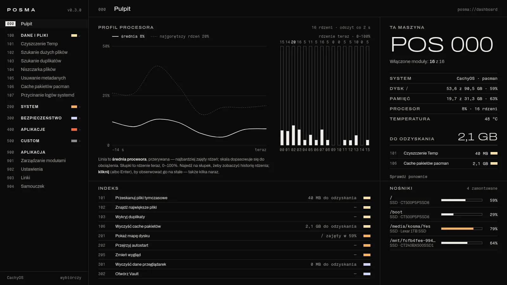
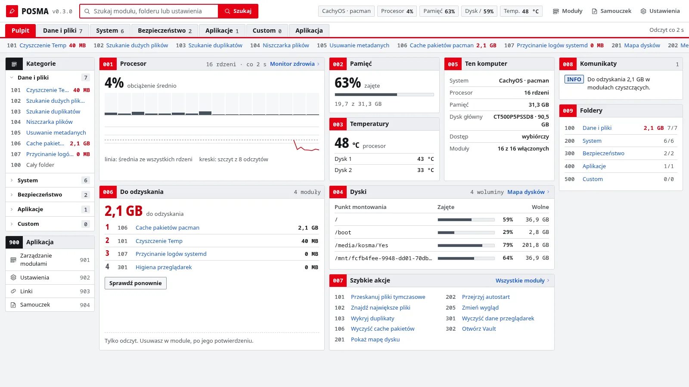
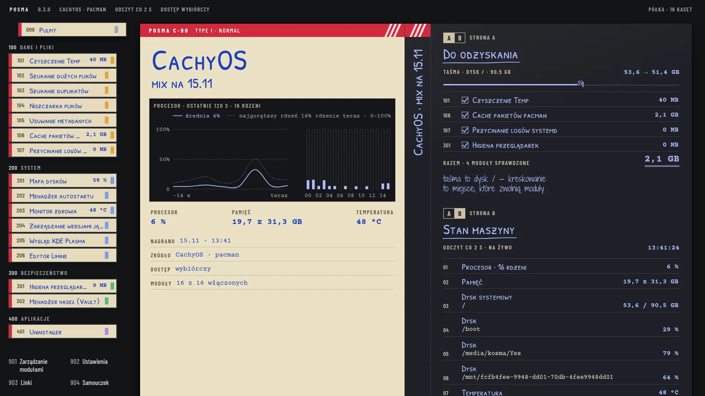
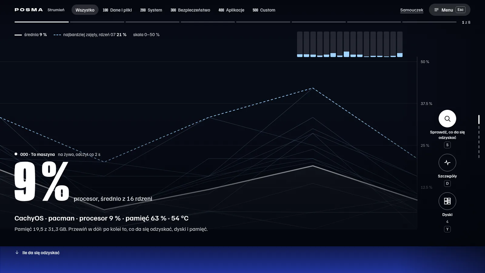
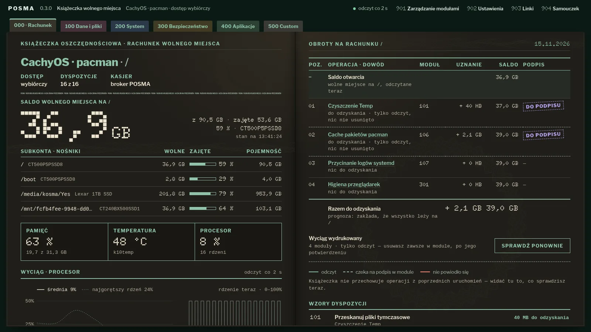
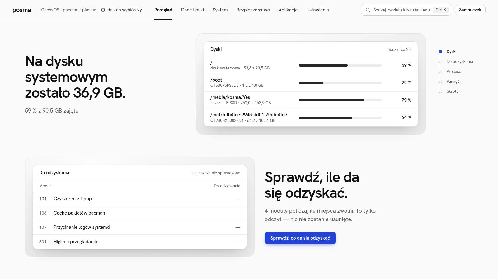

# POSMA

**P**ersonal **O**perating **S**ystem **M**aintenance **A**pp

*[Polska wersja tego dokumentu →](README.pl.md)* · *[Documentation →](https://kosmabb.github.io/Posma/)* · *[Discord →](https://discord.gg/sUanwMhk4q)*

A maintenance app for Windows, macOS and Linux whose entire source is open to
inspection — including every line that touches your system with administrator
rights. Built on Tauri (Rust core + React UI).

The idea is simple: keeping a computer in shape should be *convenient*, and
you should be able to *verify* what the tool doing it actually does. Most
maintenance software makes you pick one or the other.

> **Status: work in progress.** Linux is feature-complete against the planned
> module catalog. The app starts on a real Mac and on Arch, but its modules
> have not been tried there one by one yet; Windows has not run on real
> hardware at all. Installers for Linux (`.deb`, `.rpm`), macOS (`.dmg`) and
> Windows (`.exe`) are built from a version tag; until the first release is
> published this is a source repository.

---

## What POSMA is for

**One app, every popular system.** The same interface and the same habits on
Windows, macOS and Linux, instead of a different tool and a different mental
model per machine. Where a feature genuinely doesn't exist on a platform,
POSMA says so plainly rather than pretending.

**Not bloatware — you decide what it contains.** POSMA is a small core plus a
catalog of modules, and each module is a genuinely separate program the core
starts only when you use it — not a feature flag, not a greyed-out menu item.

The goal this architecture exists to serve:

- Don't need a password vault? Don't install it. It isn't there — not hidden,
  not disabled, *not present*.
- Changed your mind later? Install it in seconds, any time.
- Removing a module destroys **every bit of it** — the program itself and, if
  you ask, its settings and data too. No leftovers, no dormant services,
  nothing quietly staying behind.

You should never be made to install features you don't want. That is a design
constraint, not a preference — it's why modules are separate executables
rather than code compiled into one binary.

> **Where this stands before 1.0:** the separation is real — every module is its
> own executable, and the privileged operations each one may request are
> declared per module. The in-app *install/remove* flow is not finished yet:
> the module manager currently records your choice and hides what you turned
> off, rather than adding and deleting files on disk. Real on-disk
> installation and removal arrives with **1.0**, because it needs
> distribution servers to fetch module files from — see
> [Roadmap](#roadmap).
>
> This has one consequence that reads as a fault: a module added in a newer
> version will not appear by itself. The app remembers the choice made at
> first run, so a new module sits switched off in the manager until you turn
> it on there.

**Open about what it does with your system.** POSMA needs administrator
rights for some jobs — that's unavoidable for a maintenance tool. What isn't
unavoidable is asking you to take it on faith. The full source is published
so you (or anyone you trust) can read exactly what happens, and the
architecture is built so that reading it is *feasible*: the privileged parts
are small, separate and deliberately boring.

## Themes

A theme in POSMA changes the whole app, not only its colours — the
navigation, the home screen, the frame around each module. Each one has a
light and a dark mode, and your accent, contrast, fonts, corners and density
apply on top of whichever you pick.

| | |
|---|---|
| <br>**Katalog** — catalog numbers, a folder bar, the processor's profile. The default, in five variants | <br>**Gęsto** — everything on one screen: a mosaic of modules with red tabs |
| <br>**Kaseta** — the disk as tape: a shelf of cassettes, an insert with side A and side B | <br>**Strumień** — one thing across the whole screen, the next one a scroll away |
| <br>**Książeczka** — free space kept like the balance in a passbook | <br>**Monochrom** — one scale of grey, every sentence with its evidence beside it |

These six are the base themes — the ones POSMA ships with. Others will be
there to find and install: a theme will install the same way a module does,
and uninstall the same way too, arriving together with module distribution
at [1.0](#10--module-distribution). Until then a theme is built into the app,
and anyone can write one: [Writing a theme](https://kosmabb.github.io/Posma/writing-a-theme.html)
covers the language, the variable names and a starter to copy.

## Modules

23 modules are planned in total. Nine work on every system; the rest exist
because each platform has maintenance jobs the others simply don't have.

Status here means what has actually been run, not what compiles:
**✅ built and working** · **🧪 built, not yet verified on that system** ·
**📋 planned**

### Cross-platform — 9 modules

These are written once and run on Windows, macOS and Linux. All are built,
and all are verified on Linux; on macOS and Windows they are 🧪 until they
have been exercised on real hardware. On a Mac the app itself starts, which
says nothing yet about any one module.

| Module | What it does | Status |
|---|---|---|
| **Temp cleanup** | Scans and clears system and application temp folders, showing what will go before anything is deleted; on Windows also the system temp folder and Windows Update's downloads, through the broker | ✅ Linux · 🧪 macOS/Windows |
| **Large files** | Walks your home directory and ranks the biggest files so space is easy to reclaim | ✅ Linux · 🧪 macOS/Windows |
| **Duplicates** | Finds byte-identical files by SHA-256, and separately spots superseded versioned copies (`app_1.2` next to `app_1.5`) | ✅ Linux · 🧪 macOS/Windows |
| **Shredder** | Destroys picked files irrecoverably — multi-pass overwrite, rename, delete — and is honest about SSD limits | ✅ Linux · 🧪 macOS/Windows |
| **Metadata stripping** | Removes EXIF, GPS and XMP data from images before you share them, writing atomically so an interruption can't corrupt the original | ✅ Linux · 🧪 macOS/Windows |
| **Disk map** | Ranked, drill-down view of what is actually filling a drive | ✅ Linux · 🧪 macOS/Windows |
| **Health monitor** | Live CPU, memory, temperatures and graphics card; holding the graph shows the reading at a chosen moment together with the processes that caused it, and one can be ended from there | ✅ Linux · 🧪 macOS/Windows |
| **Browser hygiene** | Per-profile cache, cookie and history clearing across Firefox and Chromium-family browsers | ✅ Linux · 🧪 macOS/Windows |
| **Password vault** | Local encrypted vault (Argon2id + AES-256-GCM), folders, generator, strength and reuse audit | ✅ Linux · 🧪 macOS/Windows |

### Linux — 7 modules

| Module | What it does | Status |
|---|---|---|
| **Package caches** | Clears the download cache of the system's package manager (apt, pacman, dnf or zypper), removes orphaned packages, and reclaims superseded snap revisions | ✅ |
| **systemd journal** | Trims the journal to a target size or age, with presets instead of remembering `journalctl` flags | ✅ |
| **Autostart manager** | Lists and toggles what starts with your session; entries you add yourself can be edited and removed, entries other apps installed are never touched. On Windows: the Run key and the Startup folder, switched the way Task Manager does | ✅ Linux · 🧪 Windows |
| **Kernel versions** | Removes old kernels while the running and newest ones are locked — the privileged half re-derives both itself and refuses if it cannot tell. Where old kernels do not pile up (Arch-based systems, openSUSE) it lists them and says why there is nothing to remove | ✅ |
| **Desktop personalisation** | GTK themes, icons, cursors and interface fonts; installs a theme or a font from a folder, working out for itself which it is | ✅ GNOME · 🧪 KDE Plasma |
| **Boot editor** | GRUB: boot menu timeout, default system, and themes installed by pointing at a folder, with a preview and automatic backup and rollback. Limine, systemd-boot and rEFInd: default entry and timeout, with the same backups | ✅ GRUB · 🧪 Limine, systemd-boot, rEFInd |
| **Uninstaller** | Lists applications from the system's package manager, snap and flatpak, removes one, then finds the configuration, cache and sandbox data it left behind | ✅ |

✅ in this table means Ubuntu on real hardware. The other distributions —
twenty for home use and three for servers — are checked in containers of
each, which proves less; on Arch the app has also started on a real
machine, though its modules have not been tried there one by one.
[What was run where, and what was not](docs/distributions.md) is written
down per distribution.

### Supported Linux distributions

| Family | Distributions | What works |
|---|---|---|
| apt | Ubuntu 22.04 / 24.04 / 26.04, Debian 12 / 13, Linux Mint, Pop!_OS, Zorin OS, elementary OS, KDE neon, MX Linux, Kali | Everything |
| pacman | CachyOS, Arch Linux, Manjaro, EndeavourOS, Garuda | Everything — kernels are listed, not removed: an update replaces them instead of keeping old ones |
| dnf | Fedora, Nobara, RHEL 10 and its rebuilds (AlmaLinux 10, Rocky 10) | Everything — on RHEL 10, WebKitGTK comes from EPEL |
| zypper | openSUSE Tumbleweed | Everything — kernels are listed, not removed: openSUSE purges old ones itself |
| image-based | Bazzite, SteamOS, Fedora Silverblue | Everything except packages, kernels and GRUB, which belong to the system image |
| other | NixOS, Void, Alpine, Gentoo | Everything that does not go through the package manager |

On any of them the boot editor needs GRUB, Limine, systemd-boot or rEFInd,
and the journal module needs systemd; where either is missing the module
says so.

At first start POSMA shows what it detected — the distribution and what it
descends from, the package manager, the desktop (GNOME, KDE Plasma,
Cinnamon, MATE, Xfce, Budgie, Pantheon…) and the boot loader — and asks
whether that is right. A correction, there or later in Settings, reaches
every module: desktop personalisation drives that desktop's own settings,
and the boot editor opens for the loader that actually starts the system.

**Not supported:** RHEL 9 and its rebuilds (AlmaLinux 9, Rocky Linux 9).
The modules run, but the window cannot be built: only WebKitGTK 4.0 is
packaged there, and the app needs 4.1.

### macOS — 3 modules

| Module | What it does | Status |
|---|---|---|
| **Xcode cache** | Lists what Xcode left behind — build products, device symbols, simulator caches — marking what rebuilds itself and what cannot be recovered | 🧪 |
| **Mail and Messages slimming** | Clears what Mail and Messages rebuild by themselves — copies of opened attachments, previews, caches — and never touches mailboxes, conversations or Messages' attachments | 🧪 |
| **Time Machine snapshots** | Lists the local snapshots that consume disk between real backups and deletes them, all or all but the newest | 🧪 |

The one privileged operation among them — deleting snapshots through
`tmutil` — is written in the macOS broker, which asks for the administrator
password per action the way macOS's own prompt does. The app starts on a
real Mac, but that operation has not been tried there yet.
Homebrew, SMART and log trimming are deliberately not in it: Homebrew refuses
root and its prefix belongs to the user, macOS reads SMART without root, and
`log erase` takes no age to trim by.

### Windows — 4 modules

| Module | What it does | Status |
|---|---|---|
| **WinSxS cleanup** | DISM's report on the component store first, then the cleanup that removes superseded Windows Update files, after a System Restore point | 🧪 |
| **Service manager** | Services in ready-made profiles — telemetry, Xbox, printing, offline maps — rather than a list of hundreds; each says what stops working, and switching back restores Windows' own start types | 🧪 |
| **Bloatware removal** | Lists the Store apps Windows lets an account remove, marking the preinstalled ones, and removes the picked ones after a System Restore point | 🧪 |
| **Winget front end** | The applications with an update waiting, updated together through the system's own package manager | 🧪 |

Every critical Windows operation creates a System Restore point first — that
is a design requirement, not an option.

### Planned, not yet in the catalog

These are committed to but have no catalog entry yet, so they are not counted
in the 23 above:

| Module | What it would do | For |
|---|---|---|
| **Smart reminders** | Quiet background notice when a disk passes ~85% or memory is chronically short — a nudge when it's useful, never a nag | All systems |
| **LaunchAgents and LaunchDaemons** | The macOS side of autostart, including the system-level agents Apple hides away | macOS |

Three more are chosen and queued, in the order they'd be built:

| Module | What it would do | For |
|---|---|---|
| **Developer caches** | Separate, safe cleanup for npm, cargo, pip, gradle, go and Maven caches — routinely tens of gigabytes on a machine used for development, all of it reproducible | All systems |
| **Maintenance schedule** | Runs chosen modules on a schedule. Scan-only by default: a scheduled run reports what it found and waits, and acts unattended only where that is explicitly turned on, module by module | All systems |
| **Font manager** | Duplicate and broken fonts, and cache rebuilds — duplicated families quietly disorder font pickers and slow application startup | All systems |

Two existing modules are also planned to go further than they do: the
**autostart manager** to macOS login items (it covers Windows' Run key and
Startup folder already) and the **uninstaller** (Windows registry leftovers,
macOS `/Applications` and its scattered support files).

### What the scanners will never show

Three modules search the disk for things to remove, and all three follow one
list of exclusions. A file hidden by one and offered by another would mean
the rule counts for nothing.

The distinction is deliberate, because these are not the same question:

- **Blocked** — shown by nothing. Another operating system's volume, the
  running machine's own files, and any path you add in settings. On a
  dual-boot machine this is not theoretical: a mounted Windows volume looks
  to a scanner like ordinary files.
- **Noise** — real files nobody wrote: dependency trees, build output,
  installed games. They stay off a list headed "what can I delete", because
  removing them file by file is the wrong tool. **The disk map counts them
  normally** — there the question is where the space went, and an answer
  without them would be false.

Paths of your own go in **Settings → Scanner blacklist**: a photo archive, a
client's documents, anything that is nobody's junk.

### Settings

**Appearance** picks the theme and the light or dark mode, and on top of any
theme sets the accent colour, contrast, text and number fonts, labels,
corners, lines, density, motion and the chart. A short tour of the app
starts after the first run and can be replayed any time.

Interface scaling has six levels plus an automatic mode that follows the
window width — on dense displays and unusual resolutions the default size
can be unreadable. The access level can be changed after installation, and
tightening it from full to selective withdraws session grants immediately
rather than at the next start.

### What a module may ask for

Each module declares, in its own manifest, which classes of access it can
request — file access limited to your own data, system-wide file access,
package management, services, boot configuration, disk health, secrets,
network. It can request nothing else, and the declaration is part of what
gets reviewed.

Most of the catalog needs no administrator rights at all: of the nine
cross-platform modules, seven work entirely within your own files. The ones
that do need elevation are exactly the ones you would expect — system temp
folders, raw drive health, package caches, journal trimming, kernel removal,
boot configuration — and every one of them routes through the broker rather
than holding privileges itself.

Removing a module removes that declaration with it. Uninstall the GRUB
editor and nothing in the installation can touch boot configuration any
more, because the only thing that could is gone.


## How the privileged side is kept reviewable

Transparency only means something if the security-critical code is small
enough — and readable enough — to actually audit. So:

- **Modules never hold privileges.** They run as you. When one needs
  something privileged, it asks the core, which asks a **broker**.
- **The broker has a closed catalog of operations** — there is no "run this
  command as root" call anywhere. New privileged capabilities are added as
  reviewed operations, not by widening existing ones.
- **The broker re-validates every request itself**, never trusting what the
  unprivileged side already checked, and **fails closed** when it can't
  determine whether something is safe. Removing a kernel, for instance, makes
  the root process independently work out which kernel is running and which
  is newest, refuse both, and refuse outright if it cannot tell.
- **Destructive edits are reversible:** system config changes go through
  backup → rotation → atomic write → verification → automatic rollback if the
  verification fails.
- **Every privileged operation is recorded** in `/var/log/posma/broker.log`:
  when, for which account, what was asked and whether it worked.
- **Elevation is your choice:** a prompt per action, or an installed helper
  for prompt-free use, where access is granted by the caller's verified user
  ID rather than by file permissions.

Full design: [`Access_plan.md`](Access_plan.md). Shared implementation:
[`crates/broker-common`](crates/broker-common).

## Roadmap

Every module and feature is tested on a live system in daily use. POSMA is
not developed against virtual machines, which can differ structurally from a
real installation — the product targets operating systems as people actually
run them, so that is what it is built and verified against. Nothing ships
without being fully tested first.

That is also what sets the order below: each platform is finished on hardware
it can genuinely be tested on before the next one starts.

### Where it is now — Linux ✅

Every module planned for Linux is built and working against real system data:
temp cleanup, large files, duplicates, shredder, metadata, package caches,
systemd journal trimming, disk map, autostart, health monitor, kernel
manager, GRUB editor, browser hygiene, vault, uninstaller. The privileged
broker with its closed operation catalog is complete here, in both
prompt-per-action and installed-helper modes.

"Linux" started out meaning Ubuntu. The modules that depend on the
distribution — package caches, the uninstaller, kernel versions, the GRUB
editor — now work across the four package-manager families (apt, pacman,
dnf, zypper) and say plainly where a system offers them nothing to do, as
on image-based distributions. That is checked in a container of each
distribution rather than on installed systems — on Arch only the app
starting has been seen on a real machine so far; [Linux distributions](docs/distributions.md)
keeps the two apart.

### In testing — macOS

The second platform that can be tested live. Everything planned for it is
written; what is left is running it on real Macs.

- The app starts on a real Mac. Next is each module there, and the broker —
  the administrator prompt and Time Machine snapshots are written but have
  never run on a Mac. Every module builds for both Apple
  silicon and Intel.
- macOS-only modules: Xcode derived-data cleanup, Time Machine local
  snapshots and Mail/Messages slimming are written. The slimming takes only
  what comes back by itself; Messages' attachments are content, not cache,
  and stay for Messages' own "Review attachments", which also updates the
  conversations pointing at them.
- Full Disk Access: Settings shows whether macOS has granted it and opens
  the one pane where it is granted. POSMA never grants it itself — macOS
  makes that impossible on purpose.
- CI builds and tests every macOS module on Apple silicon and on Intel. A
  version tag builds the installers — a universal `.dmg` for the Mac, `.deb`
  and `.rpm` for Linux, an `.exe` for Windows — into a draft release.

### Then — Windows

Built with the least hardware access, so deliberately the most conservative.

- One UAC consent per run. The first operation that needs an administrator
  starts the broker through UAC; it stays connected over a pipe POSMA
  created and serves only that process, until POSMA closes. What needs no
  administrator does without one — Store apps leave the account that owns
  them, winget lists as the user.
- An installed helper that needs no consent at all is still not written:
  it would be a server anything could knock on, and the check on who knocks
  is exactly the code that should not be written blind.
- Windows-only modules: bloatware removal, WinSxS/DISM component cleanup,
  service profiles and a winget front end are written. Temp cleanup, large
  files, duplicates, browser cleanup, the health monitor and the autostart
  manager know Windows' own locations.
- Automatic restore point before every critical operation — bloatware
  removal, the service profiles and the WinSxS cleanup make one first and
  change nothing without it.
- CI builds and tests everything for Windows, including the elevated
  session end to end. None of it has run on a Windows desktop yet.

### 1.0 — module distribution

Real install and removal needs somewhere to fetch modules *from*, so both
land together at the 1.0 release:

- **Distribution servers** that POSMA requests module files from.
- **Real module install and removal** — the manager becomes genuine on-disk
  add/delete, with the choice between removing the module alone or the module
  together with its settings and data. This is what turns the modularity
  described above from architecture into a feature.
- **Module vetting** for everything served — see
  [Module security](#module-security) below.
- **Themes the same way** — a theme is found, installed and removed through
  the same manager as a module; the six base themes ship with the app.

### Long term

- **Community modules, themes, plugins and translations** — a place for other people
  to extend POSMA, with the same review standard applied to anything
  distributed through official channels.
- Polish and English are the baseline languages; the goal is for community
  translations to be first-class rather than bolted on.

### Beyond 1.0 — Master Control (business tier, exploratory)

Every office has someone who keeps the machines running, and the current
state of that job is grim: provisioning a new workstation usually means
Clonezilla and half an hour of watching a progress bar, and anything more
involved means lines of bash or an unpleasant decade-old single-purpose tool.
Intune and Jamf exist, but they are priced and scoped for organisations far
larger than the ones actually stuck with this problem.

Master Control is the plan to address that: one console, acting on any
machine on the network running POSMA — fleet-wide maintenance, workstation
provisioning, a registry of company account credentials, and scheduled
actions and policies.

This is where the commercial licence earns its keep, and it is the natural
home for the paid tier.

**It is not started, and it is intentionally last.** Turning POSMA into
something that accepts instructions over a network inverts its entire threat
model — today no component listens on a socket that isn't local, and a
compromised console would mean a compromised fleet. Three constraints are
already fixed, before any of it is designed:

1. **Off by default, always.** Installing POSMA never makes a machine
   remotely controllable. Enrolment is a deliberate, explicit act on both
   ends.
2. **The closed operation catalog still applies** — Master Control gets no
   "run this command" escape hatch, ever. Remote control that can only invoke
   reviewed operations is a fundamentally different (and much smaller) risk
   than remote shell access, and that difference is the point.
3. **The local user-ID check does not stretch over a network.** Remote access
   needs its own authenticated, mutually-verified enrolment, and every
   privileged action taken remotely lands in an audit log.

A shared company credential registry is likewise a different problem from the
current local vault — shared secrets, per-person access, revocation and audit
are not something to bolt onto a single-user design.

### Core work, regardless of platform
- **Permissions UI** — a Settings → Access view listing every capability,
  what needs it, whether it's granted, and a repair action; plus onboarding
  wired to real helper installation instead of recording a preference.
- **Custom modules** — install a module you or someone else wrote, with a
  consent screen showing exactly which privileged capabilities it declares.
- **Installers** — `.deb`, `.rpm`, a universal `.dmg` and a Windows `.exe`
  are built by [the release workflow](docs/building.md#installers), unsigned
  until there are certificates to sign with. No AppImage: the broker cannot
  be started as root from inside one.
- **Password vault — deliberately last.** The module works and is already
  cross-platform, because the encryption and the database do not depend on
  the operating system. Further work on it waits until the end of production
  regardless: it is the one module almost certain to grow (importing from
  other managers, browser integration, hardware keys), and growing it
  alongside the macOS and Windows ports would mean doing the same work twice.
- Smaller items: `pacman`/`dnf` support, flatpak unused-runtime cleanup,
  settings persistence beyond the browser store.

## Layout

```
core/            Tauri app — Rust backend (src-tauri) + React UI (src)
access/          catalog.json — the single source of truth for permissions
crates/
  broker-common/ Shared privileged-operation catalog, guards, dispatch
  distro/        Which Linux this is — package manager, kernels, GRUB layout
  scan-filter/   One list of exclusions, shared by every disk scanner
  sysmetrics/    Sensor, temperature and graphics-card readings — no privilege
modules/         One crate per feature module, plus the per-OS brokers
templates/world/ A minimal theme to copy into core/src/worlds — see Writing a theme
scripts/         sync-sidecars.mjs — builds this system's modules into the bundle
                 distro-check.sh — runs the modules in a container of each distribution
```

## Building from source

End users will get an installer; this section is for developers and for
anyone who would rather build the thing they audited.

Requires a [Rust toolchain](https://rustup.rs), Node.js 20+, and the
[Tauri system dependencies](https://tauri.app/start/prerequisites/) for your OS
— [the package names for each Linux family](docs/building.md#requirements)
are listed with the build notes.

```bash
npm --prefix core install
node scripts/sync-sidecars.mjs   # build modules, copy them into the bundle
npm --prefix core run tauri dev
```

**Run `sync-sidecars.mjs` before the first build.** Compiled module binaries
are deliberately not committed, and the app bundles them, so a fresh clone
fails until they exist. Skipping this step gives an error that looks like a
broken checkout:

```
resource path `binaries/posma-system-info-x86_64-unknown-linux-gnu` doesn't exist
```

That is the expected state before the first sync, not a corrupt clone —
`cargo build --workspace` alone will not resolve it.

Re-run the script after changing any module, too: the app uses the copied
binaries, so edits are not picked up until they are re-synced.

## Module security

Modules are the one place where POSMA could plausibly be turned against the
person running it, so anything distributed through official channels (see
[1.0 — module distribution](#10--module-distribution)) is held to a fixed
standard:

- **No external scripts.** A module does not download, generate or execute
  code from anywhere else. What ships is what runs.
- **No fetching external files, scripts or code at runtime.** A module that
  needs data brings it or asks the system for it — it does not reach out and
  pull executable content.
- **Every module is reviewed before it is served**, including its declared
  privileged capabilities, and reviewed again on every update.
- **Privileges stay inside the catalog.** A module cannot invent a new
  privileged action; it can only request operations that already exist in the
  broker's closed catalog, which is itself reviewed code.

**This is a commitment to diligence, not a guarantee of perfection.** Review
can miss things, and the right to be wrong is reserved explicitly. In
particular:

> **You are responsible for your own data and for what you choose to run.**
> Keep backups. POSMA performs destructive operations at your instruction —
> deleting files, removing packages, editing boot configuration — and while
> it is built to preview first and fail safe, the consequences of confirming
> an action are yours.
>
> **Third-party and self-installed modules are entirely at your own risk.**
> Anything you install from outside official distribution has not been
> reviewed by the author, may do anything the system permits it to do, and
> carries no assurance of any kind.

This sits alongside — and does not narrow — the warranty disclaimer in the
[license](LICENSE.md).

## Author and ownership

POSMA is created, owned and maintained by **Kosma (KosmaBB)**, sole author
and sole copyright holder.

All rights to the project, its name and its source are reserved by the
author. Contributions are welcome under the terms in
[Contributing](#contributing), and commercial licensing is arranged directly
with the author — see [COMMERCIAL-LICENSE.md](COMMERCIAL-LICENSE.md).

## Website

Planned home: **posma.com** / **posma.pl**

Neither domain is live yet — `.com` is a significant purchase and `.pl` is
currently registered to someone else, so acquiring them is pending.

Until then there are exactly two official channels: **this repository**, and
the **[Discord server](https://discord.gg/sUanwMhk4q)** for questions, module ideas and release news.
Treat any other site or server distributing something called POSMA as
unaffiliated.

The site will host downloads, the custom-module directory, documentation and
a link back here.

## Documentation and reference

| | |
|---|---|
| [Architecture](https://kosmabb.github.io/Posma/architecture.html) | How core, modules and brokers fit together, and why it is split that way |
| [Security model](https://kosmabb.github.io/Posma/security-model.html) | What can reach root, what stops it, and an explicit list of what is *not* protected |
| [Writing a module](https://kosmabb.github.io/Posma/writing-a-module.html) | The module contract — protocol, manifest, capabilities, per-OS logic, safety rules |
| [Writing a theme](https://kosmabb.github.io/Posma/writing-a-theme.html) | Your own look for the whole app — the language, the variable names, a starter to copy, the rules |
| [Building and development](https://kosmabb.github.io/Posma/building.html) | Toolchain, build order, the sidecar sync step, testing |
| [Linux distributions](https://kosmabb.github.io/Posma/distributions.html) | Which distributions POSMA runs on, what each module does there, and what was actually run to find out |
| [`Access_plan.md`](Access_plan.md) | The original permission and capability design (Polish) |

| | |
|---|---|
| [SECURITY.md](SECURITY.md) · [po polsku](SECURITY.pl.md) | Reporting a vulnerability, and what is in and out of scope |
| [CONTRIBUTING.md](CONTRIBUTING.md) · [po polsku](CONTRIBUTING.pl.md) | Ground rules, expectations and the development loop |
| [LICENSE.md](LICENSE.md) | The binding noncommercial terms |
| [COMMERCIAL-LICENSE.md](COMMERCIAL-LICENSE.md) · [po polsku](COMMERCIAL-LICENSE.pl.md) | Who pays, who doesn't, and how to arrange it |

The documentation is written in English so it stays usable for contributors
who don't read Polish. Everything a *user* needs — this README, the security
policy, the contributing guide and the licence explanations — exists in both
languages.

## Licensing

POSMA's source is published in full and dual-licensed, on the model WinRAR
popularised:

- **Free** for private individuals, research, education, charities and public
  bodies — under [PolyForm Noncommercial 1.0.0](LICENSE.md).
- **Paid** for companies and commercial use — see
  [COMMERCIAL-LICENSE.md](COMMERCIAL-LICENSE.md).

**Free commercial licences are granted at the author's discretion.** Companies
and public or state institutions can arrange free use of the paid tier by
agreeing it with the author in advance — for evaluation, for schools and
similar institutions, or simply where it makes sense. It is a grant, not an
entitlement: ask first, and it applies once agreed.

To be precise about terms: this is **source-available**, not "open source" in
the [OSI](https://opensource.org/osd) sense, because that definition forbids
restricting commercial use. Everything is readable, auditable and modifiable;
companies are simply expected to pay for commercial use.

## Contributing

Issues and pull requests are welcome — see [CONTRIBUTING.md](CONTRIBUTING.md)
for the full guide, and [SECURITY.md](SECURITY.md) for reporting anything
exploitable privately. Two ground rules, both non-negotiable because of what
this software does:

1. **No new privileged behaviour outside the broker catalog** — no `sudo`,
   `pkexec` or shell-out-as-root inside a module, however tightly scoped it
   looks.
2. **Anything destructive gets a preview first, and validation on the
   privileged side**, independent of whatever the UI already checked.

By contributing you agree your contributions are licensed under the same
dual-license terms as the project.
