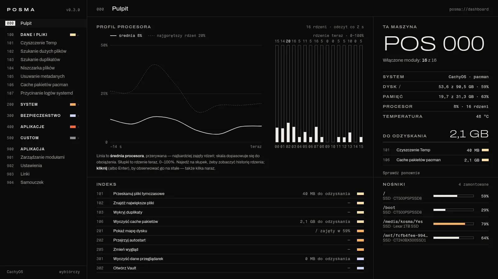
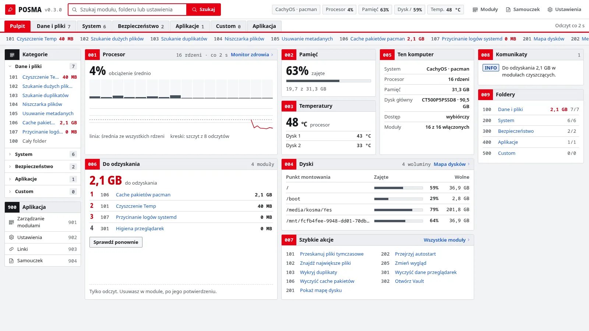
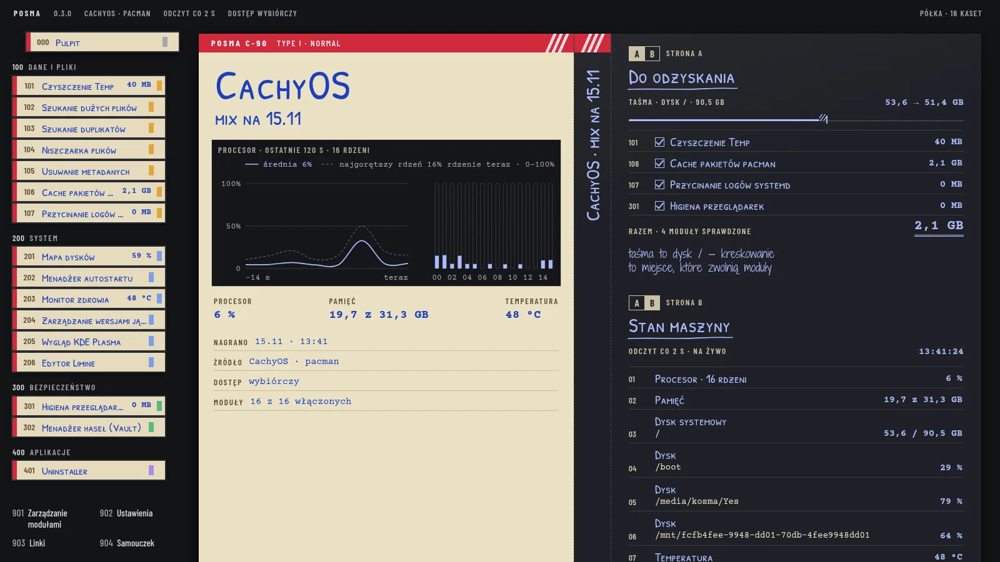
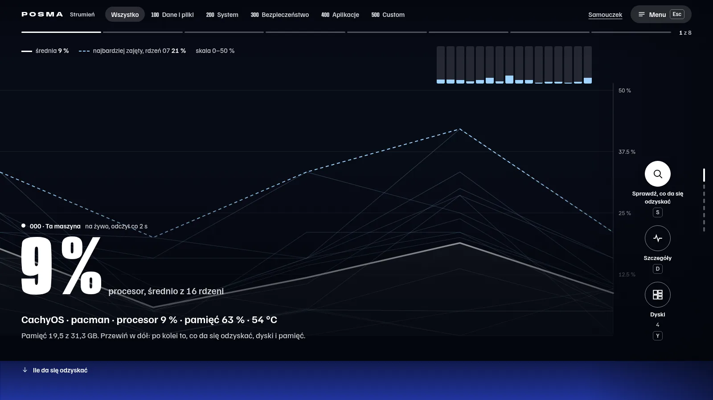
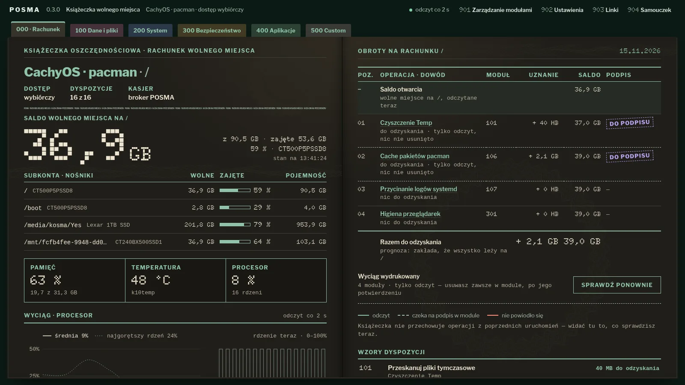
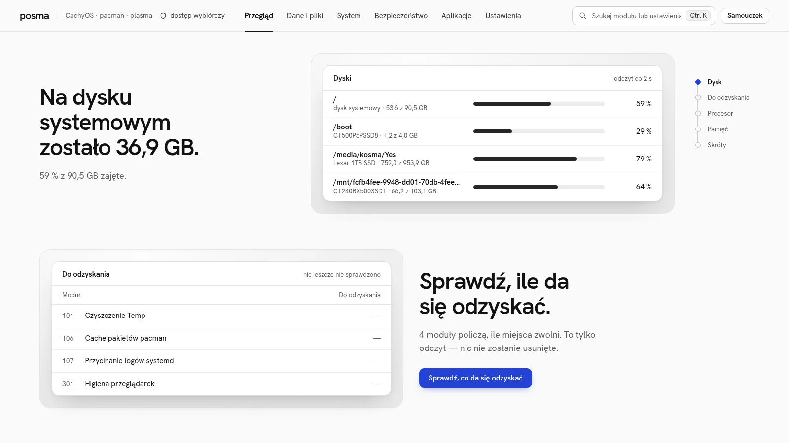

# POSMA

**P**ersonal **O**perating **S**ystem **M**aintenance **A**pp

*[English version of this document →](README.md)* · *[Dokumentacja →](https://kosmabb.github.io/Posma/pl/)* · *[Discord →](https://discord.gg/sUanwMhk4q)*

Aplikacja do konserwacji systemu na Windows, macOS i Linux, której całe
źródło jest jawne — łącznie z każdą linijką, która sięga do systemu z
uprawnieniami administratora. Zbudowana na Tauri (rdzeń w Rust, interfejs w
React).

Założenie jest proste: utrzymanie komputera w formie powinno być *wygodne*, a
Ty powinieneś móc *sprawdzić*, co narzędzie, które to robi, faktycznie robi.
Większość programów do konserwacji każe wybrać jedno albo drugie.

> **Status: w budowie.** Linux jest kompletny względem zaplanowanego katalogu
> modułów. Aplikacja uruchamia się na prawdziwym Macu i na Archu, ale jej
> moduły nie zostały tam jeszcze sprawdzone po kolei; Windows nie działał
> jeszcze na prawdziwym sprzęcie. Instalatory dla Linuksa (`.deb`, `.rpm`),
> macOS (`.dmg`) i Windows (`.exe`) buduje tag wersji; do opublikowania
> pierwszego wydania jest to repozytorium źródeł.

---

## Po co jest POSMA

**Jedna aplikacja, każdy popularny system.** Ten sam interfejs i te same
przyzwyczajenia na Windowsie, macOS-ie i Linuksie, zamiast innego narzędzia i
innego sposobu myślenia na każdej maszynie. Tam, gdzie jakiejś funkcji
naprawdę nie da się zrobić na danym systemie, POSMA mówi to wprost, zamiast
udawać.

**Żadnego bloatware'u — to Ty decydujesz, co zawiera.** POSMA to niewielki
rdzeń plus katalog modułów, a każdy moduł jest osobnym programem, który rdzeń
uruchamia dopiero wtedy, gdy z niego korzystasz — nie flagą w konfiguracji,
nie wyszarzoną pozycją w menu.

Cel, któremu ta architektura służy:

- Nie potrzebujesz menedżera haseł? Nie instaluj go. Wtedy go nie ma — nie
  jest ukryty, nie jest wyłączony, po prostu *nie istnieje*.
- Zmieniłeś zdanie? Instalujesz w kilka sekund, w dowolnym momencie.
- Usunięcie modułu unicestwia **każdy jego bit** — sam program, a jeśli
  chcesz, także jego ustawienia i dane. Żadnych pozostałości, żadnych uśpionych
  usług, nic nie zostaje po cichu.

Nikt nie powinien być zmuszany do instalowania funkcji, których nie chce. To
ograniczenie projektowe, nie preferencja — dlatego moduły są osobnymi
programami, a nie kodem wkompilowanym w jedną binarkę.

> **Stan przed 1.0:** rozdzielenie jest prawdziwe — każdy moduł to
> osobny plik wykonywalny, a uprzywilejowane operacje, o które może prosić,
> są zadeklarowane per moduł. Natomiast sam przepływ *instalacji i usuwania*
> w aplikacji nie jest jeszcze skończony: menedżer modułów na razie zapisuje
> Twój wybór i ukrywa to, co wyłączyłeś, zamiast dodawać i kasować pliki na
> dysku. Prawdziwa instalacja i usuwanie z dysku pojawią się w wersji
> **1.0**, ponieważ wymagają serwerów, z których pliki modułów będą
> pobierane — patrz [Plany](#plany).
>
> Ma to skutek, który łatwo wziąć za usterkę: moduł dodany w nowszej wersji
> nie pokaże się sam. Aplikacja pamięta wybór z pierwszego uruchomienia, więc
> nowy moduł czeka wyłączony w menedżerze, dopóki go tam nie włączysz.

## Motywy

Motyw w POSMA zmienia całą aplikację, nie tylko kolory — nawigację, ekran
główny, ramę wokół każdego modułu. Każdy ma tryb jasny i ciemny, a Twój
akcent, kontrast, kroje, narożniki i gęstość nakładają się na ten, który
wybierzesz.

| | |
|---|---|
| <br>**Katalog** — numery katalogowe, pasek folderów, profil procesora. Domyślny, w pięciu odmianach | <br>**Gęsto** — wszystko na jednym ekranie: mozaika modułów z czerwonymi zakładkami |
| <br>**Kaseta** — dysk jako taśma: półka kaset, wkładka ze stroną A i B | <br>**Strumień** — jedna rzecz na cały ekran, następna o jedno przewinięcie |
| <br>**Książeczka** — wolne miejsce prowadzone jak saldo w książeczce | <br>**Monochrom** — jedna skala szarości, każde zdanie z dowodem obok |

Tych sześć to podstawowe motywy — te, z którymi POSMA jest dostarczana.
Kolejne będzie można znaleźć i doinstalować: motyw zainstaluje się tak samo
jak moduł i tak samo da się go usunąć — pojawi się to razem z dystrybucją
modułów w [1.0](#10--dystrybucja-modułów). Do tego czasu motyw jest
wbudowany w aplikację, a napisać go może każdy:
[Pisanie motywu](https://kosmabb.github.io/Posma/pl/writing-a-theme.html)
opisuje język, nazwy zmiennych i podstawkę do skopiowania.

## Moduły

Docelowo modułów jest 23. Dziewięć działa na każdym systemie, reszta istnieje
dlatego, że każda platforma ma zadania konserwacyjne, których pozostałe po
prostu nie mają.

Status oznacza to, co zostało faktycznie uruchomione, a nie to, co się
kompiluje: **✅ zbudowany i działa** · **🧪 zbudowany, niezweryfikowany na tym systemie** · **📋 planowany**

### Wieloplatformowe — 9 modułów

Napisane raz i działające na Windowsie, macOS-ie i Linuksie. Wszystkie są
zbudowane i zweryfikowane na Linuksie; na macOS-ie i Windowsie mają status
🧪, dopóki nie zostaną sprawdzone na prawdziwym sprzęcie. Na Macu sama
aplikacja się uruchamia, co nie mówi jeszcze nic o żadnym module.

| Moduł | Co robi | Status |
|---|---|---|
| **Czyszczenie temp** | Skanuje i usuwa foldery tymczasowe systemu oraz aplikacji, pokazując zawartość do usunięcia, zanim cokolwiek zniknie; na Windowsie także systemowy folder Temp i pobrane aktualizacje Windows Update, przez brokera | ✅ Linux · 🧪 macOS/Windows |
| **Duże pliki** | Przeszukuje katalog domowy i porządkuje pliki od największych, żeby łatwo było odzyskać miejsce | ✅ Linux · 🧪 macOS/Windows |
| **Duplikaty** | Znajduje pliki identyczne co do bajtu (SHA-256), a osobno wykrywa starsze kopie wersjonowane (`app_1.2` obok `app_1.5`) | ✅ Linux · 🧪 macOS/Windows |
| **Niszczarka plików** | Kasuje wskazane pliki bezpowrotnie — wielokrotne nadpisanie, zmiana nazwy, usunięcie — i uczciwie informuje o ograniczeniach na dyskach SSD | ✅ Linux · 🧪 macOS/Windows |
| **Usuwanie metadanych** | Usuwa dane EXIF, GPS i XMP ze zdjęć przed udostępnieniem, zapisując atomowo, żeby przerwanie nie uszkodziło oryginału | ✅ Linux · 🧪 macOS/Windows |
| **Mapa dysków** | Uporządkowany podgląd z możliwością wchodzenia w głąb, pokazujący co faktycznie zajmuje dysk | ✅ Linux · 🧪 macOS/Windows |
| **Monitor zdrowia** | CPU, RAM, temperatury i karta graficzna na żywo; zatrzymanie wykresu pokazuje odczyt z wybranej chwili razem z procesami, które go wywołały, a proces da się z tego miejsca zakończyć | ✅ Linux · 🧪 macOS/Windows |
| **Higiena przeglądarek** | Czyszczenie cache, ciasteczek i historii osobno dla każdego profilu, dla Firefoksa i przeglądarek opartych na Chromium | ✅ Linux · 🧪 macOS/Windows |
| **Menedżer haseł** | Lokalny, szyfrowany sejf (Argon2id + AES-256-GCM): foldery, generator haseł, ocena siły i audyt powtórzeń | ✅ Linux · 🧪 macOS/Windows |

### Linux — 7 modułów

| Moduł | Co robi | Status |
|---|---|---|
| **Cache pakietów** | Czyści cache pobranych pakietów menedżera systemu (apt, pacman, dnf lub zypper), usuwa pakiety osierocone i odzyskuje miejsce po starych rewizjach snapów | ✅ |
| **Logi systemd** | Przycina dziennik do zadanego rozmiaru lub wieku, na gotowych ustawieniach zamiast pamiętania flag `journalctl` | ✅ |
| **Menedżer autostartu** | Pokazuje i przełącza programy startujące z sesją; wpisy dodane samodzielnie można edytować i usuwać, wpisów założonych przez inne aplikacje moduł nigdy nie rusza. Na Windowsie: klucz Run i folder Autostart, przełączane tak jak w Menedżerze zadań | ✅ Linux · 🧪 Windows |
| **Wersje jądra** | Usuwa stare jądra, blokując aktywne i najnowsze — część uprzywilejowana sama je ustala i odmawia, jeśli nie potrafi tego stwierdzić. Tam, gdzie stare jądra się nie odkładają (systemy oparte na Archu, openSUSE), pokazuje listę i wyjaśnia, dlaczego nie ma czego usuwać | ✅ |
| **Personalizacja pulpitu** | Motywy GTK, ikony, kursory i czcionki interfejsu; instalacja motywu lub czcionki przez wskazanie folderu, z automatycznym rozpoznaniem, co to jest | ✅ GNOME · 🧪 KDE Plasma |
| **Edytor rozruchu** | GRUB: czas oczekiwania, domyślny system i motywy instalowane przez wskazanie folderu, z podglądem oraz automatyczną kopią zapasową i wycofaniem zmian. Limine, systemd-boot i rEFInd: domyślny wpis i czas oczekiwania, z tymi samymi kopiami | ✅ GRUB · 🧪 Limine, systemd-boot, rEFInd |
| **Uninstaller** | Wyświetla aplikacje z menedżera pakietów systemu, snap i flatpak, odinstalowuje wybraną, a potem znajduje pozostawione przez nią pliki konfiguracji, cache i dane sandboksa | ✅ |

✅ w tej tabeli oznacza Ubuntu na prawdziwym sprzęcie. Pozostałe dystrybucje —
dwadzieścia domowych i trzy serwerowe — są sprawdzane w kontenerach każdej z
nich, co dowodzi mniej; na Archu aplikacja uruchomiła się też na prawdziwej
maszynie, choć jej modułów nie sprawdzono tam jeszcze po kolei.
[Co uruchomiono gdzie, a czego nie](docs/pl/distributions.md) jest spisane
osobno dla każdej dystrybucji.

### Obsługiwane dystrybucje Linuksa

| Rodzina | Dystrybucje | Co działa |
|---|---|---|
| apt | Ubuntu 22.04 / 24.04 / 26.04, Debian 12 / 13, Linux Mint, Pop!_OS, Zorin OS, elementary OS, KDE neon, MX Linux, Kali | Wszystko |
| pacman | CachyOS, Arch Linux, Manjaro, EndeavourOS, Garuda | Wszystko — jądra są pokazywane, nie usuwane: aktualizacja je podmienia, zamiast zostawiać stare |
| dnf | Fedora, Nobara, RHEL 10 i jego przebudowy (AlmaLinux 10, Rocky 10) | Wszystko — na RHEL 10 WebKitGTK pochodzi z EPEL |
| zypper | openSUSE Tumbleweed | Wszystko — jądra są pokazywane, nie usuwane: openSUSE samo czyści stare |
| oparte na obrazie | Bazzite, SteamOS, Fedora Silverblue | Wszystko poza pakietami, jądrami i GRUB-em, które należą do obrazu systemu |
| pozostałe | NixOS, Void, Alpine, Gentoo | Wszystko, co nie przechodzi przez menedżer pakietów |

Na każdej z nich edytor rozruchu wymaga GRUB, Limine, systemd-boot albo
rEFInd, a moduł dziennika — systemd; gdzie czegoś brakuje, moduł mówi o tym
wprost.

Przy pierwszym uruchomieniu POSMA pokazuje, co wykryła — dystrybucję i to, od
czego pochodzi, menedżer pakietów, pulpit (GNOME, KDE Plasma, Cinnamon, MATE,
Xfce, Budgie, Pantheon…) i program rozruchowy — i pyta, czy się zgadza.
Poprawka, wtedy albo później w Ustawieniach, trafia do każdego modułu:
personalizacja pulpitu zmienia ustawienia właściwego środowiska, a edytor
rozruchu otwiera się dla programu, który faktycznie uruchamia system.

**Nieobsługiwane:** RHEL 9 i jego przebudowy (AlmaLinux 9, Rocky Linux 9).
Moduły działają, ale okna nie da się zbudować: jest tam tylko WebKitGTK 4.0,
a aplikacja potrzebuje 4.1.

### macOS — 3 moduły

| Moduł | Co robi | Status |
|---|---|---|
| **Cache Xcode** | Wylicza, co Xcode zostawił — wyniki kompilacji, symbole urządzeń, cache symulatorów — z zaznaczeniem, co odbuduje się samo, a czego nie da się odzyskać | 🧪 |
| **Odchudzanie Mail i Messages** | Czyści to, co Poczta i Wiadomości odbudują same — kopie otwartych załączników, podglądy, cache — i nigdy nie dotyka skrzynek, rozmów ani załączników Wiadomości | 🧪 |
| **Migawki Time Machine** | Pokazuje lokalne migawki zajmujące dysk pomiędzy właściwymi kopiami zapasowymi i usuwa wszystkie albo wszystkie poza najnowszą | 🧪 |

Jedyna operacja uprzywilejowana wśród nich — usuwanie migawek przez
`tmutil` — jest napisana w brokerze macOS, który przy każdej akcji prosi o hasło
administratora tak, jak robi to sam macOS. Aplikacja uruchamia się na
prawdziwym Macu, ale tej operacji jeszcze tam nie sprawdzono.
Homebrew, SMART i przycinania logów celowo w nim nie ma: Homebrew nie
działa jako root, a jego katalog należy do użytkownika, SMART macOS czyta bez
roota, a `log erase` nie przyjmuje wieku, według którego miałby przycinać.

### Windows — 4 moduły

| Moduł | Co robi | Status |
|---|---|---|
| **Czyszczenie WinSxS** | Najpierw raport DISM o magazynie komponentów, potem czyszczenie usuwające zastąpione pliki Windows Update, po utworzeniu punktu przywracania | 🧪 |
| **Menedżer usług** | Usługi w gotowych profilach — telemetria, Xbox, drukowanie, mapy offline — zamiast listy setek pozycji; każdy mówi, co przestanie działać, a powrót przywraca typy uruchamiania nadane przez Windows | 🧪 |
| **Usuwanie bloatware** | Pokazuje aplikacje Sklepu, które Windows pozwala usunąć z konta, oznacza fabryczne i usuwa wybrane po utworzeniu punktu przywracania | 🧪 |
| **Interfejs winget** | Aplikacje z czekającą aktualizacją, aktualizowane razem przez systemowy menedżer pakietów | 🧪 |

Każda krytyczna operacja na Windowsie najpierw tworzy punkt przywracania
systemu — to wymóg projektowy, nie opcja.

### Planowane, jeszcze poza katalogiem

Te są przesądzone, ale nie mają jeszcze wpisu w katalogu, więc nie liczą się
do powyższych 23:

| Moduł | Co ma robić | Dla |
|---|---|---|
| **Inteligentne przypomnienia** | Dyskretne powiadomienie, gdy dysk przekroczy ~85% zajętości albo pamięci chronicznie brakuje — podpowiedź wtedy, kiedy jest przydatna, nigdy uprzykrzanie się | Wszystkie systemy |
| **LaunchAgents i LaunchDaemons** | Macowa strona autostartu, łącznie z agentami systemowymi, które Apple trzyma w ukryciu | macOS |
| **Cache narzędzi programistycznych** | Osobne, bezpieczne czyszczenie cache npm, cargo, pip, gradle, go i Mavena — na maszynie używanej do programowania rutynowo kilkadziesiąt gigabajtów, w całości odtwarzalnych | Wszystkie systemy |
| **Harmonogram konserwacji** | Uruchamia wybrane moduły cyklicznie. Domyślnie wyłącznie skanowanie: zaplanowane zadanie pokazuje, co znalazło, i czeka, a działa bezobsługowo tylko tam, gdzie zostanie to wprost włączone, moduł po module | Wszystkie systemy |
| **Menedżer czcionek** | Duplikaty, uszkodzone czcionki i przebudowa cache — zdublowane rodziny po cichu rozstrajają listy wyboru czcionek i spowalniają start programów | Wszystkie systemy |

Dwa istniejące moduły mają też docelowo sięgać dalej niż teraz: **menedżer
autostartu** do elementów logowania macOS (klucz Run i folder Autostart
Windows już obsługuje) oraz **uninstaller** (pozostałości w rejestrze
Windows, `/Applications` i porozrzucane pliki wsparcia na macOS).

### Czego skanery nigdy nie pokażą

Trzy moduły przeszukują dysk w poszukiwaniu rzeczy do usunięcia i wszystkie
trzy trzymają się jednej listy wykluczeń. Plik ukryty w jednym, a widoczny w
drugim, oznaczałby, że zasada nic nie znaczy.

Rozróżnienie jest celowe, bo to nie to samo pytanie:

- **Zablokowane** — nie pokazuje ich nic. Dysk drugiego systemu, pliki
  systemowe działającej maszyny i ścieżki, które sam dodasz w ustawieniach.
  Przy dwusystemowym komputerze to nie teoria: zamontowany dysk Windows
  wygląda dla skanera jak zwykłe pliki.
- **Szum** — prawdziwe pliki, których nikt nie napisał: drzewa zależności,
  wyniki kompilacji, zainstalowane gry. Nie pojawiają się na liście „co mogę
  usunąć", bo kasowanie ich plik po pliku to zły sposób. **Mapa dysków liczy
  je normalnie** — tam pytanie brzmi „gdzie poszło miejsce", a odpowiedź bez
  nich byłaby fałszywa.

Własne ścieżki dodajesz w **Ustawieniach → Czarna lista skanerów**: archiwum
zdjęć, dokumenty klienta, cokolwiek, co nie jest niczyim śmieciem.

### Ustawienia

**Wygląd** wybiera motyw i tryb jasny lub ciemny, a na każdym motywie
ustawia kolor akcentu, kontrast, krój tekstu i liczb, etykiety, narożniki,
linie, gęstość, ruch i wykres. Po pierwszym uruchomieniu startuje krótki
samouczek po aplikacji; można go powtórzyć w każdej chwili.

Skalowanie interfejsu ma sześć poziomów plus tryb automatyczny dobierający
się do szerokości okna — przy gęstych ekranach i niestandardowych
rozdzielczościach domyślny rozmiar bywa nieczytelny. Poziom dostępu można
zmienić po instalacji, a zaostrzenie go z pełnego na wybiórczy odbiera
uprawnienia sesyjne od razu, nie przy następnym uruchomieniu.

### O co moduł może poprosić

Każdy moduł deklaruje we własnym manifeście, o jakie klasy dostępu może
prosić — pliki ograniczone do Twoich własnych danych, pliki systemowe,
menedżer pakietów, usługi, konfigurację rozruchu, zdrowie dysków, sekrety,
sieć. O nic poza tym poprosić nie może, a sama deklaracja jest częścią tego,
co podlega weryfikacji.

Większość katalogu w ogóle nie potrzebuje uprawnień administratora: spośród
dziewięciu modułów wieloplatformowych siedem działa wyłącznie w obrębie
Twoich plików. Te, które faktycznie wymagają podniesienia uprawnień, to
dokładnie te, których można się spodziewać — systemowe foldery tymczasowe,
surowy odczyt zdrowia dysku, cache pakietów, przycinanie dziennika, usuwanie
jąder, konfiguracja rozruchu — i każdy z nich przechodzi przez brokera,
zamiast trzymać uprawnienia u siebie.

Usunięcie modułu usuwa razem z nim tę deklarację. Odinstaluj edytor GRUB-a, a
nic w instalacji nie będzie już w stanie dotknąć konfiguracji rozruchu,
ponieważ jedyna rzecz, która mogła, przestała istnieć.


## Dlaczego uprzywilejowaną część da się zweryfikować

Jawność źródła ma sens tylko wtedy, gdy kod krytyczny dla bezpieczeństwa jest
na tyle mały i łatwy w odczycie, że realnie da się go przejrzeć. Dlatego:

- **Moduły nigdy nie mają uprawnień.** Działają na Twoim koncie, z Twoimi
  uprawnieniami. Kiedy któryś potrzebuje czegoś uprzywilejowanego, zwraca
  się do rdzenia, a rdzeń do **brokera**.
- **Broker ma zamknięty katalog operacji** — nigdzie nie ma wywołania „wykonaj
  to polecenie jako root”. Nowe możliwości dodaje się jako przejrzane
  operacje, nie przez rozszerzanie istniejących.
- **Broker sam waliduje każde żądanie**, nie ufając temu, co sprawdziła już
  strona nieuprzywilejowana, i **odmawia**, gdy nie potrafi ustalić, czy coś
  jest bezpieczne. Przy usuwaniu jądra proces roota samodzielnie ustala,
  które jądro jest uruchomione i które najnowsze, i odmawia usunięcia obu, a jeśli
  nie potrafi tego ustalić — odmawia w ogóle.
- **Zmiany destrukcyjne są odwracalne:** modyfikacje konfiguracji systemowej
  przechodzą przez kopię zapasową → rotację → zapis atomowy → weryfikację →
  automatyczne cofnięcie, jeśli weryfikacja się nie powiedzie.
- **Każda operacja uprzywilejowana jest zapisywana** w
  `/var/log/posma/broker.log`: kiedy, dla którego konta, o co poproszono i czy
  się udało.
- **Sposób podnoszenia uprawnień wybierasz Ty:** pytanie przy każdej akcji
  albo zainstalowany pomocnik działający bez pytań, gdzie dostęp przyznawany
  jest na podstawie zweryfikowanego identyfikatora użytkownika, a nie
  uprawnień pliku.

Pełny opis projektu: [`Access_plan.md`](Access_plan.md). Wspólna implementacja:
[`crates/broker-common`](crates/broker-common).

## Plany

Każdy moduł i każda funkcja są testowane na żywym systemie, z którego korzystam
codziennie. Nie tworzymy maszyn wirtualnych, które mogłyby różnić się budową od
realnej instalacji — chcemy pełnej zgodności z systemami operacyjnymi w takiej
postaci, w jakiej ludzie faktycznie z nich korzystają. Zapewniamy, że każda
funkcja jest w pełni przetestowana przed wydaniem.

To też wyznacza kolejność poniżej: każdy system jest kończony na sprzęcie, na
którym da się go realnie testować, zanim zacznie się następny.

### Stan obecny — Linux ✅

Wszystkie moduły zaplanowane dla Linuksa są zbudowane i działają na
prawdziwych danych systemowych: czyszczenie temp, duże pliki, duplikaty,
niszczarka, metadane, cache pakietów, przycinanie logów systemd, mapa dysku,
autostart, monitor zdrowia, menedżer jądra, edytor GRUB, higiena
przeglądarek, sejf, uninstaller. Broker z zamkniętym katalogiem operacji jest
tutaj kompletny, w obu trybach — pytania przy akcji i zainstalowanego
pomocnika.

„Linux" oznaczał na początku Ubuntu. Moduły zależne od dystrybucji — cache
pakietów, uninstaller, wersje jądra, edytor GRUB — działają teraz na czterech
rodzinach menedżerów pakietów (apt, pacman, dnf, zypper) i mówią wprost, gdy
system nie daje im nic do zrobienia, jak na dystrybucjach opartych na obrazie.
Sprawdzane jest to w kontenerze każdej dystrybucji, a nie na zainstalowanych
systemach — na Archu na prawdziwej maszynie widać było na razie tylko
uruchomienie aplikacji; strona [Dystrybucje Linuksa](docs/pl/distributions.md) rozdziela te
dwie rzeczy.

### W trakcie testów — macOS

Drugi system, który da się testować na żywo. Wszystko, co dla niego
zaplanowano, jest napisane; zostało uruchomienie tego na prawdziwych Macach.

- Aplikacja uruchamia się na prawdziwym Macu. Następne są tam kolejne moduły
  i broker — prośba o hasło administratora i migawki Time Machine są
  napisane, ale nigdy nie uruchomione na Macu. Każdy moduł
  buduje się na Apple silicon i Intela.
- Moduły wyłącznie dla macOS: czyszczenie DerivedData Xcode, lokalne
  migawki Time Machine i odchudzanie Mail i Messages są napisane.
  Odchudzanie bierze tylko to, co wraca samo; załączniki Wiadomości to
  treść, nie cache, i zostają dla wbudowanego w Wiadomości „Przejrzyj
  załączniki”, które przy okazji poprawia wskazujące na nie rozmowy.
- Pełny dostęp do dysku: Ustawienia pokazują, czy macOS go nadał, i otwierają
  jedyny panel, w którym się go nadaje. POSMA nigdy nie nadaje go sama —
  macOS celowo to uniemożliwia.
- CI buduje i testuje każdy moduł macOS na Apple silicon i na Intelu. Tag
  wersji buduje instalatory — uniwersalny `.dmg` dla Maca, `.deb` i `.rpm`
  dla Linuksa, `.exe` dla Windows — do szkicu wydania.

### Potem — Windows

Budowany przy najmniejszym dostępie do sprzętu, więc celowo najostrożniej.

- Jedna zgoda UAC na uruchomienie. Pierwsza operacja wymagająca
  administratora uruchamia brokera przez UAC; zostaje on połączony potokiem,
  który utworzyła POSMA i który obsługuje tylko ten proces, aż do zamknięcia
  POSMA. Co nie wymaga administratora, obywa się bez niego — aplikacje
  Sklepu znikają z konta, do którego należą, winget listuje jako
  użytkownik.
- Zainstalowanego pomocnika, który nie potrzebuje żadnej zgody, wciąż nie
  ma: byłby serwerem, do którego może zapukać cokolwiek, a sprawdzenie, kto
  puka, to właśnie kod, którego nie pisze się na ślepo.
- Moduły wyłącznie dla Windows: usuwanie bloatware, czyszczenie WinSxS/DISM,
  profile usług i interfejs winget są napisane. Czyszczenie temp, duże
  pliki, duplikaty, przeglądarki, monitor zdrowia i menedżer autostartu
  znają windowsowe lokalizacje.
- Automatyczny punkt przywracania przed każdą operacją krytyczną — usuwanie
  bloatware, profile usług i czyszczenie WinSxS najpierw go tworzą i bez
  niego niczego nie zmieniają.
- CI buduje i testuje wszystko pod Windows, łącznie z sesją uprzywilejowaną
  od początku do końca. Nic z tego nie działało jeszcze na windowsowym
  pulpicie.

### 1.0 — dystrybucja modułów

Prawdziwa instalacja i usuwanie potrzebują miejsca, *z którego* moduły są
pobierane, więc jedno i drugie pojawia się razem w wydaniu 1.0:

- **Serwery dystrybucyjne**, do których POSMA wysyła prośbę o pliki modułów.
- **Prawdziwa instalacja i usuwanie modułów** — menedżer zaczyna faktycznie
  dodawać i kasować pliki na dysku, z wyborem między usunięciem samego
  modułu a modułu razem z jego ustawieniami i danymi. To zamienia opisaną
  wyżej modułowość z architektury w funkcję.
- **Weryfikacja modułów** dla wszystkiego, co jest serwowane — patrz
  [Bezpieczeństwo modułów](#bezpieczeństwo-modułów).
- **Motywy tak samo** — motyw znajduje się, instaluje i usuwa w tym samym
  menedżerze co moduł; sześć podstawowych motywów jest dostarczanych z
  aplikacją.

### Długoterminowo

- **Moduły, motywy, wtyczki i tłumaczenia społeczności** — miejsce, w którym inni
  mogą rozbudowywać POSMA, przy tym samym standardzie weryfikacji dla
  wszystkiego, co idzie oficjalnym kanałem.
- Polski i angielski są językami bazowymi; celem jest, żeby tłumaczenia
  społeczności były pełnoprawne, a nie doklejone.

### Po 1.0 — Master Control (wersja firmowa, koncepcja)

W każdym biurze jest ktoś, kto utrzymuje komputery przy życiu, a stan tej
pracy jest kiepski: przygotowanie stanowiska dla nowego pracownika to zwykle
Clonezilla i pół godziny patrzenia na pasek postępu, a cokolwiek bardziej
złożonego to linijki basha albo nieporęczne, jednozadaniowe narzędzie sprzed dekady.
Intune i Jamf istnieją, ale ceną i skalą celują w organizacje znacznie
większe niż te, które faktycznie mają ten problem.

Master Control to plan, żeby to rozwiązać: jedna konsola, działająca na
dowolnej maszynie w sieci z uruchomionym POSMA — konserwacja całej floty,
przygotowywanie stanowisk, rejestr haseł do kont firmowych oraz harmonogramy
i polityki konkretnych akcji.

To właśnie tutaj licencja komercyjna zaczyna zarabiać na siebie i to jest
naturalne miejsce na płatny wariant.

**Nie jest zaczęte i celowo jest ostatnie.** Zamiana POSMA w coś, co
przyjmuje polecenia przez sieć, odwraca cały model zagrożeń projektu — dziś
żaden komponent nie nasłuchuje na gnieździe innym niż lokalne, a przejęta
konsola oznaczałaby przejętą flotę. Trzy ograniczenia są ustalone już teraz,
zanim cokolwiek zostanie zaprojektowane:

1. **Domyślnie wyłączone, zawsze.** Instalacja POSMA nigdy nie czyni maszyny
   sterowalną zdalnie. Dołączenie do floty to świadoma, jawna czynność po
   obu stronach.
2. **Zamknięty katalog operacji nadal obowiązuje** — Master Control nigdy nie
   dostanie furtki „wykonaj to polecenie”. Zdalne sterowanie, które potrafi
   wywołać wyłącznie przejrzane operacje, to zupełnie inne (i dużo mniejsze)
   ryzyko niż zdalna powłoka — i to jest właśnie sedno.
3. **Lokalna weryfikacja identyfikatora użytkownika nie rozciąga się na
   sieć.** Dostęp zdalny wymaga własnego, wzajemnie uwierzytelnionego
   dołączania, a każda uprzywilejowana akcja wykonana zdalnie trafia do
   dziennika audytu.

Wspólny firmowy rejestr haseł to również inny problem niż obecny lokalny
sejf — sekrety współdzielone, dostęp per osoba, odbieranie uprawnień i audyt
to nie są rzeczy, które dokleja się do projektu jednoosobowego.

### Prace wspólne, niezależne od systemu

- **Interfejs uprawnień** — widok Ustawienia → Dostępy z listą każdego
  uprawnienia, tym co go potrzebuje, jego stanem i akcją naprawy; plus
  onboarding podpięty do realnej instalacji pomocnika zamiast zapisywania
  preferencji.
- **Moduły własne** — instalacja modułu napisanego przez Ciebie lub kogoś
  innego, z ekranem zgody pokazującym dokładnie, o jakie uprzywilejowane
  możliwości prosi.
- **Instalatory** — `.deb`, `.rpm`, uniwersalny `.dmg` i `.exe` dla Windows
  buduje [workflow wydań](docs/pl/building.md#instalatory), bez podpisu, dopóki
  nie ma certyfikatów. Bez AppImage: z jego wnętrza nie da się uruchomić
  brokera jako root.
- **Sejf haseł — świadomie na koniec.** Moduł działa i jest wieloplatformowy
  już dziś, bo szyfrowanie i baza nie zależą od systemu. Dalsza praca nad nim
  czeka jednak na sam koniec produkcji: to jedyny moduł, który prawie na
  pewno urośnie (import z innych menedżerów, integracja z przeglądarką,
  klucze sprzętowe), a rozbudowywanie go równolegle do portowania na macOS i
  Windows oznaczałoby przerabianie tego samego dwa razy.
- Drobniejsze: obsługa `pacman`/`dnf`, czyszczenie nieużywanych środowisk
  flatpak, trwałe zapisywanie ustawień.

## Struktura

```
core/            Aplikacja Tauri — backend w Rust (src-tauri) + interfejs React (src)
access/          catalog.json — jedyne źródło prawdy o uprawnieniach
crates/
  broker-common/ Wspólny katalog operacji uprzywilejowanych, zabezpieczenia, dyspozytor
  distro/        Jaki to Linux — menedżer pakietów, jądra, układ GRUB
  scan-filter/   Jedna lista wykluczeń dla wszystkich skanerów dysku
  sysmetrics/    Odczyt czujników, temperatur i kart graficznych — bez uprawnień
modules/         Po jednym crate na moduł, plus brokery per system
templates/world/ Minimalny motyw do skopiowania do core/src/worlds — patrz Pisanie motywu
templates/translation/ Wszystkie teksty interfejsu po angielsku, do przetłumaczenia — patrz Pisanie tłumaczenia
scripts/         sync-sidecars.mjs — buduje moduły dla tego systemu i wgrywa je do aplikacji
                 check-translations.mjs — sprawdza każdy plik językowy z polskimi kluczami
                 distro-check.sh — uruchamia moduły w kontenerze każdej dystrybucji
```
## Budowanie ze źródeł

Użytkownik końcowy dostanie instalator; ta sekcja jest dla programistów i dla
tych, którzy wolą sami zbudować to, co zaudytowali.

Wymagane: [Rust](https://rustup.rs), Node.js 20+ oraz
[zależności systemowe Tauri](https://tauri.app/start/prerequisites/) dla
Twojego systemu — [nazwy pakietów dla każdej rodziny Linuksa](docs/pl/building.md#wymagania)
są spisane przy opisie budowania.

```bash
npm --prefix core install
node scripts/sync-sidecars.mjs   # zbuduj moduły i skopiuj je do aplikacji
npm --prefix core run tauri dev
```

**Uruchom `sync-sidecars.mjs` przed pierwszym budowaniem.** Skompilowane
binarki modułów celowo nie są commitowane, a aplikacja je dołącza, więc
świeży klon nie zbuduje się, dopóki nie powstaną. Pominięcie tego kroku daje
błąd, który wygląda jak uszkodzone repozytorium:

```
resource path `binaries/posma-system-info-x86_64-unknown-linux-gnu` doesn't exist
```

To oczekiwany stan przed pierwszą synchronizacją, a nie zepsuty klon — samo
`cargo build --workspace` tego nie rozwiąże.

Skrypt trzeba uruchomić ponownie także po każdej zmianie w module: aplikacja
korzysta ze skopiowanych binarek, więc zmiany nie są widoczne, dopóki nie
zostaną zsynchronizowane.

## Bezpieczeństwo modułów

Moduły to jedyne miejsce, w którym POSMA mógłby realnie zostać obrócony
przeciwko osobie, która go uruchomiła, więc wszystko dystrybuowane
oficjalnym kanałem (patrz [1.0 — dystrybucja modułów](#10--dystrybucja-modułów))
podlega stałemu standardowi:

- **Zero zewnętrznych skryptów.** Moduł nie pobiera, nie generuje i nie
  wykonuje kodu skądkolwiek indziej. To, co jest dostarczone, jest tym, co
  się uruchamia.
- **Żadnego pobierania zewnętrznych plików, skryptów ani kodu w trakcie
  działania.** Moduł, który potrzebuje danych, przynosi je ze sobą albo pyta
  o nie system — nie sięga na zewnątrz po treści wykonywalne.
- **Każdy moduł jest sprawdzany, zanim trafi na serwer**, łącznie z
  zadeklarowanymi uprawnieniami, i sprawdzany ponownie przy każdej
  aktualizacji.
- **Uprawnienia nie wychodzą poza katalog.** Moduł nie może wymyślić nowej
  uprzywilejowanej akcji — może wyłącznie prosić o operacje, które już
  istnieją w zamkniętym katalogu brokera, a ten sam jest przejrzanym kodem.

**To zobowiązanie do staranności, nie gwarancja nieomylności.** Weryfikacja
może czegoś nie wychwycić i prawo do pomyłki jest tu wyraźnie zastrzeżone. W
szczególności:

> **Odpowiadasz za swoje dane i za to, co decydujesz się uruchomić.** Rób
> kopie zapasowe. POSMA wykonuje operacje destrukcyjne na Twoje polecenie —
> kasuje pliki, usuwa pakiety, edytuje konfigurację rozruchu — i choć jest
> zbudowana tak, by najpierw pokazać podgląd i zawodzić bezpiecznie, skutki
> potwierdzenia akcji są Twoje.
>
> **Moduły zewnętrzne i instalowane samodzielnie są wyłącznie na Twoje
> ryzyko.** Cokolwiek zainstalujesz spoza oficjalnej dystrybucji, nie zostało
> sprawdzone przez autora, może zrobić wszystko, na co pozwoli mu system, i
> nie wiąże się z żadną gwarancją.

To uzupełnia — i w niczym nie zawęża — wyłączenie odpowiedzialności zawarte w
[licencji](LICENSE.md).

## Autor i własność

POSMA jest tworzony, posiadany i rozwijany przez **Kosmę (KosmaBB)**,
jedynego autora i jedynego właściciela praw autorskich.

Wszelkie prawa do projektu, jego nazwy i jego źródła są zastrzeżone przez
autora. Wkład społeczności jest mile widziany na warunkach opisanych w sekcji
[Współpraca](#współpraca), a licencje komercyjne ustalane są bezpośrednio z
autorem — patrz [COMMERCIAL-LICENSE.md](COMMERCIAL-LICENSE.md).

## Strona

Planowany adres: **posma.com** / **posma.pl**

Żadna z domen jeszcze nie działa — `.com` to spory wydatek, a `.pl` jest
obecnie zarejestrowana na kogoś innego, więc ich pozyskanie jest w toku.

Do tego czasu oficjalne kanały są dokładnie dwa: **to repozytorium** oraz
**[serwer Discord](https://discord.gg/sUanwMhk4q)** — na pytania, pomysły na moduły i informacje o
wydaniach. Wszystkie inne strony i serwery dystrybuujące coś pod nazwą POSMA
należy traktować jako niepowiązane z projektem.

Na stronie znajdą się pliki do pobrania, katalog modułów własnych,
dokumentacja i odnośnik z powrotem tutaj.

## Dokumentacja i odnośniki

| | |
|---|---|
| [Architektura](https://kosmabb.github.io/Posma/pl/architecture.html) | Jak rdzeń, moduły i brokery łączą się w całość i dlaczego podział wygląda właśnie tak |
| [Model bezpieczeństwa](https://kosmabb.github.io/Posma/pl/security-model.html) | Co może sięgnąć do roota, co go przed tym powstrzymuje i jawna lista tego, co **nie** jest chronione |
| [Pisanie modułu](https://kosmabb.github.io/Posma/pl/writing-a-module.html) | Kontrakt modułu — protokół, manifest, uprawnienia, logika per system, zasady bezpieczeństwa |
| [Pisanie motywu](https://kosmabb.github.io/Posma/pl/writing-a-theme.html) | Własny wygląd całej aplikacji — język, nazwy zmiennych, podstawka do skopiowania, zasady |
| [Pisanie tłumaczenia](https://kosmabb.github.io/Posma/pl/writing-a-translation.html) | POSMA w twoim języku — format pliku, formy liczby mnogiej, wzór, sprawdzanie |
| [Budowanie i praca z kodem](https://kosmabb.github.io/Posma/pl/building.html) | Wymagania, kolejność budowania, krok synchronizacji modułów, testowanie |
| [Dystrybucje Linuksa](https://kosmabb.github.io/Posma/pl/distributions.html) | Na których dystrybucjach POSMA działa, co każdy moduł tam robi i co faktycznie uruchomiono, żeby to ustalić |
| [`Access_plan.md`](Access_plan.md) | Pierwotny projekt systemu uprawnień (po polsku) |

| | |
|---|---|
| [SECURITY.pl.md](SECURITY.pl.md) · [English](SECURITY.md) | Zgłaszanie podatności oraz co jest i co nie jest w zakresie |
| [CONTRIBUTING.pl.md](CONTRIBUTING.pl.md) · [English](CONTRIBUTING.md) | Zasady, oczekiwania i tryb pracy z kodem |
| [LICENSE.md](LICENSE.md) | Wiążące warunki niekomercyjne (tekst angielski) |
| [COMMERCIAL-LICENSE.pl.md](COMMERCIAL-LICENSE.pl.md) · [English](COMMERCIAL-LICENSE.md) | Kto płaci, kto nie i jak to uzgodnić |

Dokumentacja istnieje po polsku i po
[angielsku](https://kosmabb.github.io/Posma/), tak samo jak wszystko, czego
potrzebuje *użytkownik* — to README, polityka bezpieczeństwa, przewodnik dla
współtwórców i wyjaśnienia licencji. Tylko wiążący tekst licencji jest
wyłącznie po angielsku.

## Licencja

Źródło POSMA jest publikowane w całości i objęte podwójną licencją, na
modelu spopularyzowanym przez WinRAR:

- **Bezpłatnie** dla osób prywatnych, nauki, edukacji, organizacji
  charytatywnych i instytucji publicznych — na warunkach
  [PolyForm Noncommercial 1.0.0](LICENSE.md).
- **Odpłatnie** dla firm i zastosowań komercyjnych — patrz
  [COMMERCIAL-LICENSE.md](COMMERCIAL-LICENSE.md).

**Darmowe licencje komercyjne przyznawane są uznaniowo przez autora.** Firmy
oraz podmioty publiczne i państwowe mogą uzyskać bezpłatny dostęp do wersji
płatnej po wcześniejszym uzgodnieniu tego z autorem — na testy, dla szkół i
podobnych instytucji, albo po prostu tam, gdzie to ma sens. To przyznanie
uprawnienia, a nie roszczenie: najpierw pytanie, a obowiązuje od momentu
uzgodnienia.

Żeby być precyzyjnym: to licencja **source-available**, a nie „open source” w
rozumieniu [OSI](https://opensource.org/osd), ponieważ tamta definicja
zabrania ograniczania użytku komercyjnego. Wszystko jest czytelne,
audytowalne i modyfikowalne; od firm oczekuje się po prostu opłaty za użytek
komercyjny.

## Współpraca

Zgłoszenia i pull requesty są mile widziane — pełny przewodnik w
[CONTRIBUTING.md](CONTRIBUTING.md), a zgłaszanie podatności prywatnie opisuje
[SECURITY.md](SECURITY.md). Dwie zasady, obie nienegocjowalne ze względu na
to, co ten program robi:

1. **Żadnych nowych uprzywilejowanych zachowań poza katalogiem brokera** —
   żadnego `sudo`, `pkexec` ani wywołań jako root wewnątrz modułu, choćby
   wyglądały na maksymalnie wąskie.
2. **Wszystko, co destrukcyjne, dostaje najpierw podgląd, a walidację po
   stronie uprzywilejowanej**, niezależnie od tego, co sprawdził już
   interfejs.

Przesyłając wkład, zgadzasz się, że jest on objęty tymi samymi warunkami
podwójnej licencji co projekt.
